# Doctor Tracker

**Doctor Tracker is a secure admin portal for clinics and hospital groups to manage doctors and the patients under their care.** Admins register doctors, add, edit and remove patients under each one, and find any record quickly with search, filters and pagination. A live analytics dashboard shows admission trends, caseload per doctor, patient status, conditions and demographics. Every list query is backed by a MongoDB index, the UI works on phone and desktop in light and dark mode, and access requires an authenticated session with role-based permissions.

| | |
|---|---|
| **Frontend** | Next.js 16 (App Router) · React 19 · TypeScript · Tailwind CSS v4 · TanStack Query · React Hook Form + Zod · Recharts |
| **Backend** | Node.js · Express 5 · TypeScript · Mongoose 9 · Zod · jose (JWT) · bcrypt |
| **Database** | MongoDB 7 |
| **Demo logins** | `admin@doctortracker.dev` / `Admin@123` (full access) · `viewer@doctortracker.dev` / `Viewer@123` (read-only) |

---

## Contents

1. [Features](#features)
2. [Setup guide](#setup-guide)
3. [System architecture](#system-architecture)
4. [Technical decisions](#technical-decisions)
5. [Performance & query optimization](#performance--query-optimization)
6. [Visual evidence](#visual-evidence)
7. [API reference](#api-reference)
8. [Project structure](#project-structure)
9. [Scalability considerations](#scalability-considerations)

---

## Features

**Authentication & authorization**
- Email/password login. Passwords are hashed with bcrypt (cost 12). Unknown emails take the same time to reject as wrong passwords, so attackers cannot discover which accounts exist.
- The session is a signed JWT stored in an **httpOnly, SameSite=Lax cookie**. JavaScript never sees the token.
- Protected in two layers: a Next.js `proxy.ts` verifies the JWT signature before any page renders, and the Express API checks it again on every request.
- Role-based access: `admin` can read and write. `viewer` is read-only; the UI hides write actions and the API returns `403` if they are attempted.
- Login is rate-limited (10 failed attempts per 15 minutes). `?next=` redirects only to paths on this site, preventing open redirects.

**Doctors**
- Create, edit and delete doctors (name, specialization, hospital, phone, email). Email must be unique.
- Search as you type across name, email, phone, hospital and specialization.
- Filter by specialization, hospital and joined date range. Sort by newest, oldest, name or most patients.
- Paginated with a choice of 10, 20 or 50 rows per page.
- The doctor profile page lists that doctor's patients (searchable and paginated) and lets admins add and remove patients there.

**Patients**
- A dedicated page lists every patient with search (name, phone, email, condition), pagination and filters for **condition**, **status**, gender, assigned doctor and admission date range.
- Edit any patient, including reassigning them to another doctor, and delete with confirmation. Deletes are optimistic: the row disappears immediately and comes back if the request fails.

**Dashboard**
- KPI tiles: total doctors, total patients, new admissions (with % change against the previous period) and critical cases.
- Charts: admissions over time, patients per doctor (top 10), patient status breakdown, age groups and gender split, top conditions, and caseload by specialization.
- Range switcher (7 days, 30 days, 90 days, 12 months). Time buckets adjust to the range (daily, weekly or monthly).
- Every chart has a **Table** toggle that shows the same data as an accessible table.

**UX**
- Responsive: a sidebar on desktop, a drawer on mobile, and tables that turn into stacked cards on small screens.
- Light and dark themes with no flash on load. The choice is remembered and defaults to the OS setting.
- Search, filters, sort and page number live in the URL, so views can be shared, bookmarked, refreshed, and navigated with back/forward.
- Skeleton loaders on first load. When paging, the previous page stays visible (dimmed) until the next one arrives. Each list has a specific empty state.
- Forms validate as you type, server errors (e.g. "email already in use") appear under the relevant field, and every action gives toast feedback.
- Accessibility: native `<dialog>` for modals (focus trapping and Esc to close), a skip link, labelled controls, `aria-invalid` and `aria-describedby` on form errors, status shown with icon plus label (never color alone), and reduced-motion support.

---

## Setup guide

### Prerequisites
- **Node.js ≥ 20.12** (developed on Node 24)
- **MongoDB ≥ 6**, either local or Atlas. If you don't have one, run `docker compose up -d` to start MongoDB 7 on `localhost:27017`.

### 1. Install
```bash
git clone <repo-url> doctor-tracker
cd doctor-tracker
npm run install:all          # installs root, backend and frontend dependencies
```

### 2. Configure environment
Each app ships an `.env.example`:

```bash
cp backend/.env.example backend/.env
cp frontend/.env.example frontend/.env.local
```

Generate a secret and put the **same value** in both files as `JWT_SECRET`:

```bash
node -e "console.log(require('crypto').randomBytes(48).toString('base64url'))"
```

| File | Variable | Purpose |
|---|---|---|
| `backend/.env` | `PORT` | API port (default `4000`) |
| | `MONGODB_URI` | e.g. `mongodb://127.0.0.1:27017/doctor_tracker` |
| | `JWT_SECRET` | ≥ 32 chars; signs session tokens |
| | `JWT_EXPIRES_IN` | Session lifetime (default `8h`) |
| | `CORS_ORIGIN` | Origins allowed to call the API directly (comma-separated) |
| `frontend/.env.local` | `BACKEND_URL` | Where Next.js forwards `/api/*` (default `http://localhost:4000`) |
| | `JWT_SECRET` | Same value as the backend; lets `proxy.ts` verify sessions |

The backend checks its environment with Zod on startup and exits with a clear message if anything is missing or invalid.

### 3. Seed demo data
```bash
npm run seed
```
This creates 2 users, 48 doctors across 10 specializations and 6 hospitals, and about 2,800 patients spread over the last 14 months. The data is deterministic, so every seed is identical. **The seed wipes the users, doctors and patients collections first.**

### 4. Run
```bash
npm run dev        # API → http://localhost:4000/api   ·   Web → http://localhost:3000
```
Open http://localhost:3000 and use a demo login (the login page has one-click buttons for both accounts).

For production, run `npm run build && npm start`. You can also run each app on its own with `npm --prefix backend run dev` and `npm --prefix frontend run dev`. If port 3000 is taken, use `npm --prefix frontend run dev -- -p 3100`.

---

## System architecture

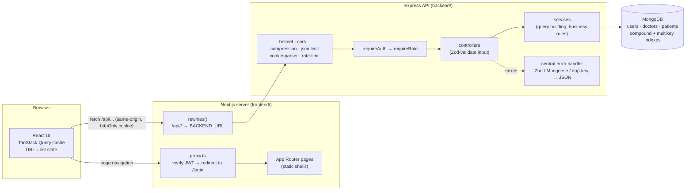

**Request flow**

1. **Page request:** `proxy.ts` runs first and verifies the `dt_session` JWT (signature, issuer, expiry) with `jose`. Invalid or missing sessions are redirected to `/login?next=…` and a bad cookie is cleared. Signed-in users visiting `/login` go to `/dashboard`. Pages are static shells that hydrate on the client.
2. **Data request:** the browser calls same-origin `/api/...`. Next.js `rewrites()` forwards it to the standalone Express server, so the session cookie is first-party and the backend URL is never exposed.
3. **API pipeline:** security middleware → `requireAuth` (JWT from the cookie, or a `Bearer` header for API clients) → `requireRole('admin')` on writes → the controller validates params, query and body with Zod → the service builds an index-friendly query → the response comes back as `{ data, meta }` or `{ error: { code, message, details } }`.
4. **Client cache:** TanStack Query caches each response by a key built from its filters. After a write, related queries are invalidated (doctors, patients and stats), so counts and charts stay in sync without a manual refresh.

**Backend layering**: `routes` (HTTP wiring and role checks) → `controllers` (parse/validate, shape the response) → `services` (all Mongo access and business rules) → `models` (schema and indexes). Validation lives in `validators/` and is shared by every route that needs it.

---

## Technical decisions

### 1. Search: a prefix-matched keyword index instead of `$text` or unanchored regex

**The problem.** Admins type partial terms such as "car" (Cardiology), "rah" (Rahman) or "1755" (part of a phone number) and expect results as they type. The obvious MongoDB options both fall short:

| Approach | Partial match? | Uses an index? | Problem |
|---|---|---|---|
| `{ name: /car/i }` (unanchored, case-insensitive) | ✅ | ❌ full collection scan | Gets linearly slower as the collection grows; needs one `$or` branch per field |
| `$text` index | ❌ whole stemmed words only | ✅ | "car" doesn't match "Cardiology", and partial phone numbers don't match at all; only one text index per collection |
| Atlas Search | ✅ | ✅ | Excellent, but ties local development and evaluation to Atlas |

**The decision.** Each searchable document stores a `keywords: string[]` of normalized tokens (lowercase, accents stripped) built from all of its searchable fields, with a separate digits-only copy of phone numbers. A Mongoose `pre('validate')` hook keeps it up to date on create and update, so it can't drift from the source fields. The field has a **multikey index**, and each search token becomes an **anchored, case-sensitive regex**:

```js
// "rahman card" →
{ $and: [ { keywords: { $regex: '^rahman' } }, { keywords: { $regex: '^card' } } ] }
```

An anchored, case-sensitive regex reads only the matching range of the index (`IXSCAN` on `[ "card", "care" )`), so the cost depends on the number of matches, not the collection size. Multi-word queries are ANDed, which gives "type more to narrow it down" behaviour. See [`backend/src/utils/search.ts`](backend/src/utils/search.ts).

**Trade-offs.** It matches word prefixes, not substrings inside words, which is what people expect from a search-as-you-type box. It uses a little extra storage per document (the keyword array is excluded from API responses with `select: false`). There is no relevance ranking; results follow the chosen sort order, which suits an admin list better than a relevance score would. If fuzzy matching or ranking were ever needed, the `keywordFilter()` function could be swapped for Atlas Search without touching controllers or the UI.

### 2. Auth & data flow: httpOnly cookie behind a same-origin rewrite, server state in TanStack Query + URL (no Redux)

**Where the token lives.** Many SPA tutorials keep the JWT in `localStorage` and attach it as a header. Then any XSS bug, including one in a third-party package, can read the token and send it elsewhere. Instead, the API sets the JWT as an **httpOnly, SameSite=Lax** cookie, which page scripts cannot read. Because the frontend and API are separate servers, a direct cross-origin call would make the cookie third-party, and browsers increasingly block those. So the Next.js app **proxies `/api/*` to Express with `rewrites()`**. The browser only ever talks to one origin, the cookie is first-party, CORS isn't needed in production, and the API host stays private. SameSite=Lax plus JSON-only bodies handle CSRF for state-changing requests.

Having the cookie on the Next.js origin also lets `proxy.ts` **cryptographically verify** the session before rendering. Unauthenticated users never see a flash of the app shell, and expired sessions are redirected cleanly. The API still checks auth on every request (defence in depth), and roles are enforced server-side regardless of what the UI hides.

**Why not Redux.** Almost all of this app's state is *server* state: lists, details and stats that live in MongoDB. Redux (even RTK) would mean hand-writing loading flags, cache invalidation and request de-duplication. TanStack Query provides all of that, plus request cancellation (the `AbortSignal` is passed to `fetch`), `keepPreviousData` so paging doesn't flicker, background refetching, and optimistic updates with rollback. The remaining *UI* state (search, filters, sort, page, dashboard range) goes in the **URL** through a small `useUrlState` hook. That makes every view shareable, bookmarkable and refresh-safe, and lets the back button work, which a global store would not. The only React Context is the theme. Query keys are centralized in [`lib/query-keys.ts`](frontend/src/lib/query-keys.ts), so invalidation is precise. For example, adding a patient invalidates `['doctors']`, `['patients']` and `['stats']`, which refreshes the doctor's patient count and the dashboard.

---

## Performance & query optimization

**Indexes** (defined in the Mongoose models and built at startup in dev):

| Collection | Index | Serves |
|---|---|---|
| doctors | `{ email: 1 }` unique | uniqueness, duplicate detection → `409` |
| doctors | `{ keywords: 1 }` (multikey) | prefix search |
| doctors | `{ createdAt: -1, _id: -1 }` | default list, "joined" date range |
| doctors | `{ specialization: 1, createdAt: -1, _id: -1 }` | filter + sort (equality → sort → range) |
| doctors | `{ hospital: 1, createdAt: -1, _id: -1 }` | filter + sort |
| doctors | `{ patientCount: -1, _id: -1 }`, `{ name: 1, _id: 1 }` | "most patients" / name sort, dashboard top-10 |
| patients | `{ doctor: 1, admissionDate: -1, _id: -1 }` | a doctor's patient list |
| patients | `{ admissionDate: -1, _id: -1 }` | default list, date range, dashboard `$match` |
| patients | `{ condition: 1, admissionDate: -1, _id: -1 }` | condition filter, `distinct('condition')` |
| patients | `{ status: 1, admissionDate: -1, _id: -1 }` | status filter |
| patients | `{ keywords: 1 }`, `{ name: 1, _id: 1 }` | search, name sort |

**Why `_id` is in the sort indexes.** Pagination sorts by `{ field, _id }` so pages stay stable when values tie. Without `_id` in the index, MongoDB has to do an in-memory `SORT` stage. With it, pages are read straight from the index, and the tiebreaker follows the sort direction so ascending sorts walk the same index in reverse. Verified with `explain()` on the seeded data:

```
status=critical, newest   LIMIT ← FETCH ← IXSCAN(status_1_admissionDate_-1__id_-1)   docsExamined=10
status=critical, oldest   LIMIT ← FETCH ← IXSCAN(status_1_admissionDate_-1__id_-1)   docsExamined=10
sort by name              LIMIT ← FETCH ← IXSCAN(name_1__id_1)                       docsExamined=10
doctors by patientCount   LIMIT ← FETCH ← IXSCAN(patientCount_-1__id_-1)             docsExamined=10
```

**Query patterns**
- **Pagination:** the page query and the count run in parallel (`Promise.all`). With no filter, the count uses `estimatedDocumentCount()`, which reads collection metadata and costs O(1). All reads use `.lean()` (plain objects, no Mongoose document overhead) and a projection that drops internal fields.
- **Denormalized `patientCount`** on each doctor, maintained with atomic `$inc` on patient create, delete and reassignment. This makes "sort by most patients" and the "patients per doctor" chart simple index scans instead of a `$lookup` or `$group` over every patient. The seed script recomputes the counts from the patients collection, and the end-to-end test confirmed zero drift after a full create/edit/reassign/delete cycle.
- **Dashboard:** 4 round-trips in parallel. One `$facet` aggregation over patients starts with a single indexed `$match` covering the current and previous windows, then computes trend buckets (`$dateTrunc`), condition, status, gender and age (`$bucket`) breakdowns and the period-over-period counts in one pass. Alongside it run one small `$facet` over doctors, one top-10 index scan, and two metadata counts. Empty time buckets are filled in on the server so charts never have gaps.
- **Filter dropdown values** come from `distinct()` on indexed fields and are cached for 60 s (`Cache-Control: private, max-age=60`) plus 5 min in the client cache.
- **Delete-doctor guard** uses `Patient.exists()`, which stops at the first match.

**Frontend**
- Recharts (the largest dependency) is loaded with `next/dynamic` in its own chunk, so the KPI tiles render before the chart code has loaded.
- `optimizePackageImports` for `lucide-react` and `recharts` keeps only the icons and charts actually used.
- Search input is debounced (300 ms) while keystrokes update the field instantly. In-flight requests are aborted when filters change.
- Table columns and row renderers are memoized, `Pagination` is wrapped in `memo`, and URL-state setters keep stable identities (they read `window.location` at call time).
- The theme is applied by a tiny inline script before first paint, so there is no flash of the wrong theme.

---

## Visual evidence

Screenshots are taken from the production build against the seeded database. They are in [`docs/screenshots/`](docs/screenshots).

### Desktop

| Dashboard (light) | Dashboard (dark) |
|---|---|
| 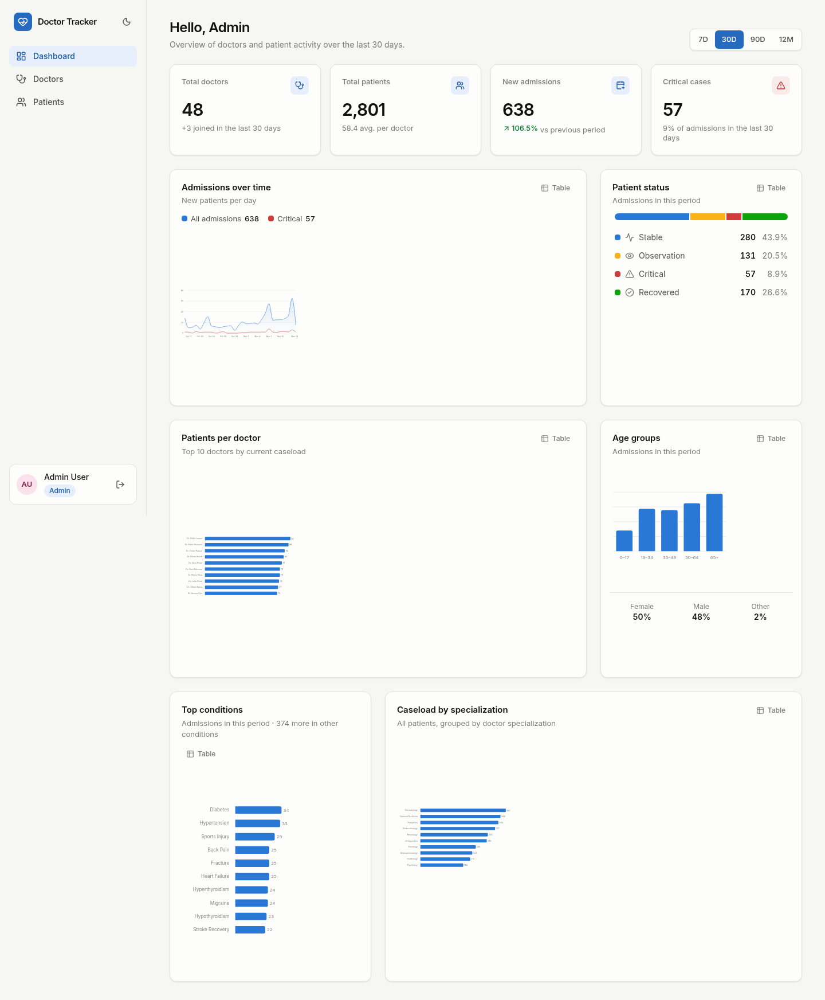 | 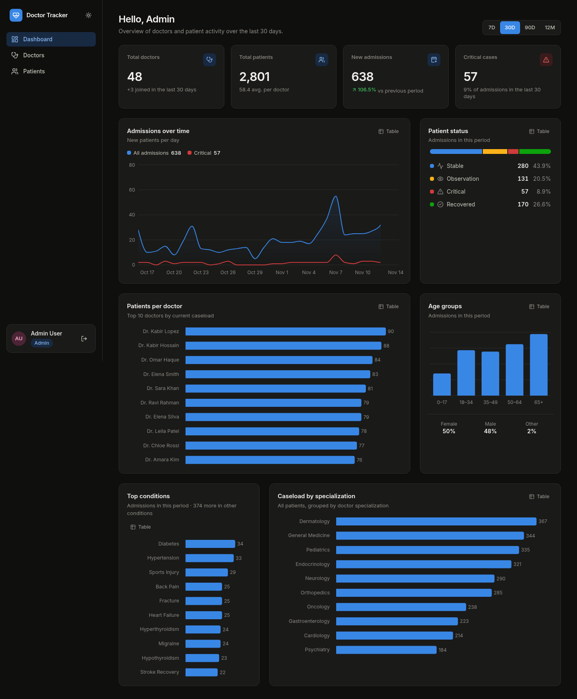 |

| Doctors | Doctor profile & patients |
|---|---|
| 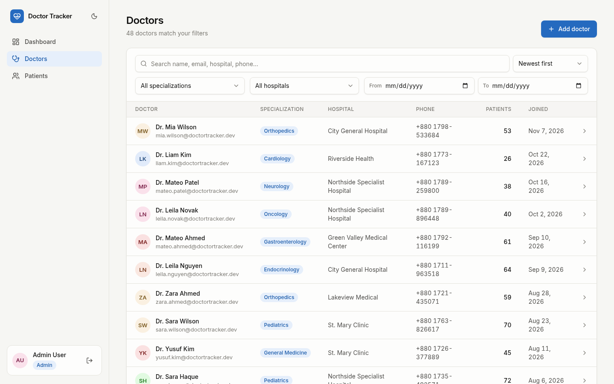 | 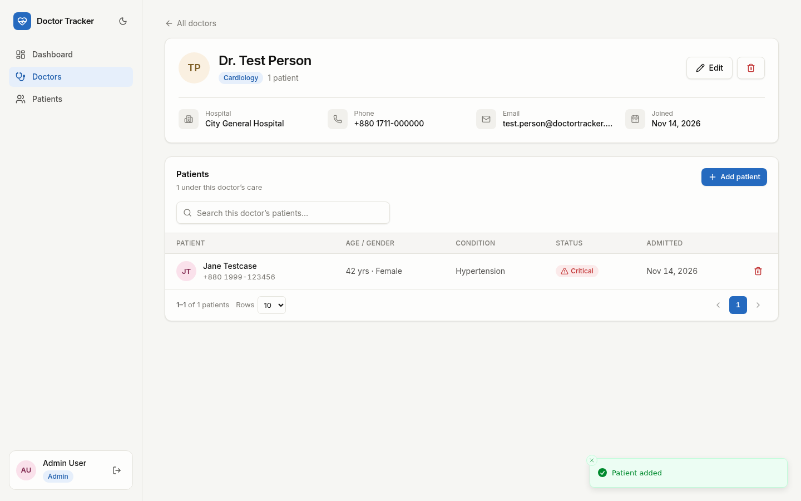 |

| Patients (filtered: critical) | Add patient |
|---|---|
| 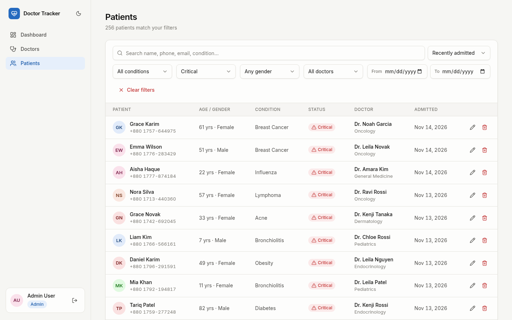 | 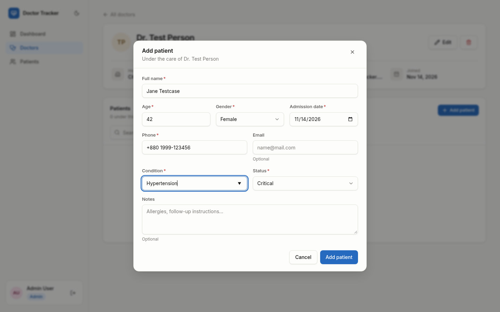 |

| Login |
|---|
| 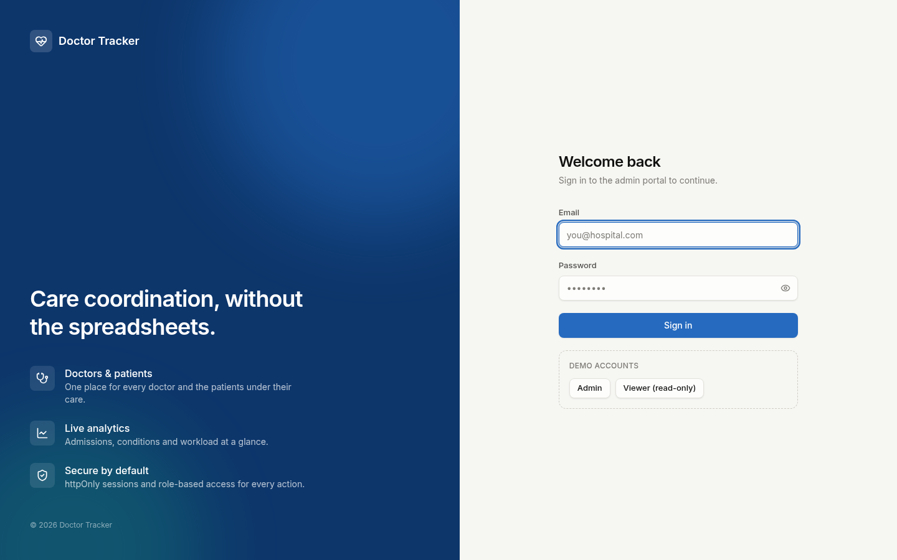 |

### Mobile

| Login | Dashboard | Doctors | Patients + filters | Navigation |
|---|---|---|---|---|
| 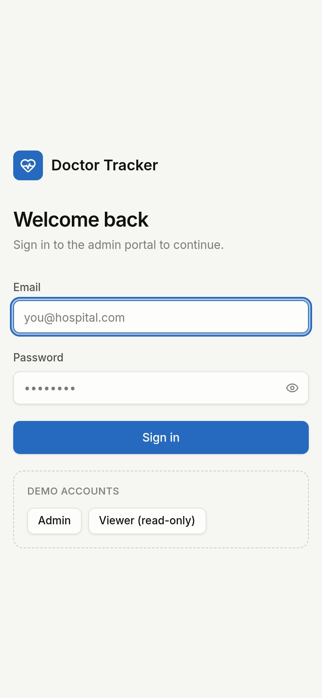 | 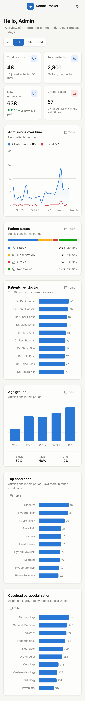 | 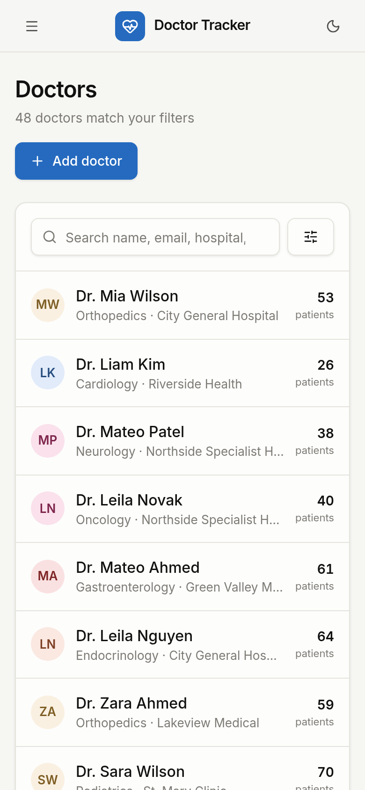 | 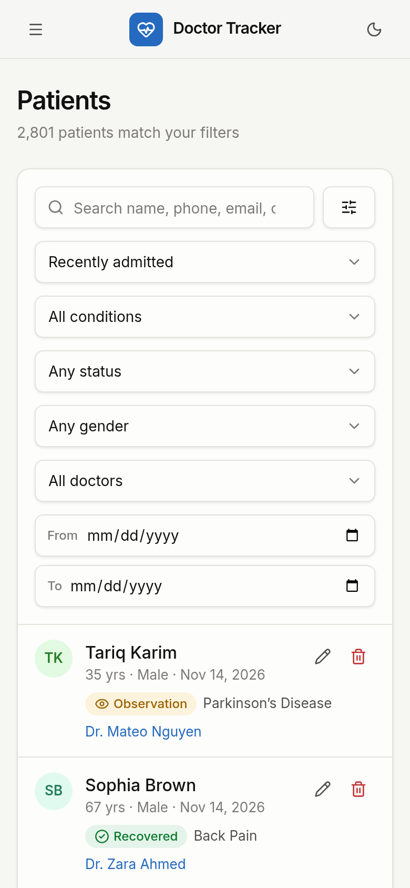 | 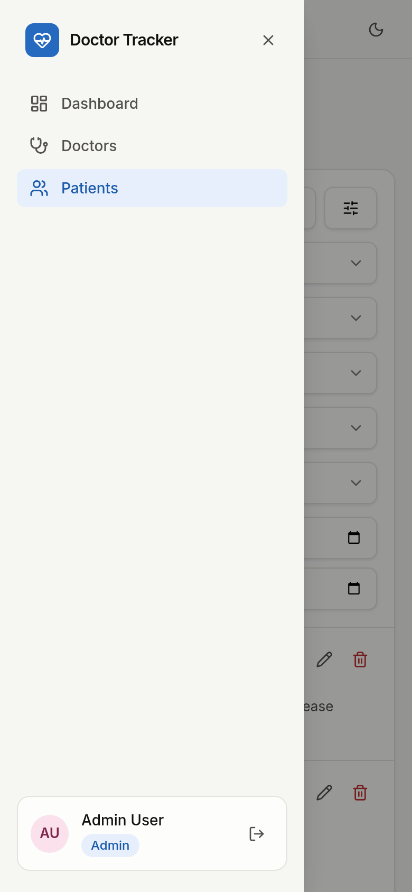 |

---

## API reference

Base URL: `/api`. Every route except `/auth/login`, `/auth/logout` and `/health` requires a session. ✏️ marks routes that require the `admin` role.

| Method | Path | Description |
|---|---|---|
| `POST` | `/auth/login` | `{ email, password }` → sets the session cookie, returns the user |
| `POST` | `/auth/logout` | Clears the session cookie |
| `GET` | `/auth/me` | Current user |
| `GET` | `/doctors` | `?page&limit&search&specialization&hospital&from&to&sort=newest\|oldest\|name\|patients` |
| `POST` ✏️ | `/doctors` | Create a doctor |
| `GET` | `/doctors/facets` | Distinct specializations and hospitals |
| `GET` | `/doctors/options` | `{ _id, name, specialization }[]` for pickers |
| `GET` | `/doctors/:id` | Doctor detail |
| `PATCH` ✏️ | `/doctors/:id` | Partial update |
| `DELETE` ✏️ | `/doctors/:id` | `409` if the doctor still has patients |
| `GET` | `/doctors/:id/patients` | That doctor's patients (same query params as `/patients`) |
| `POST` ✏️ | `/doctors/:id/patients` | Add a patient under the doctor |
| `DELETE` ✏️ | `/doctors/:id/patients/:patientId` | Remove a patient from the doctor's list |
| `GET` | `/patients` | `?page&limit&search&condition&status&gender&doctor&from&to&sort=newest\|oldest\|name\|age` |
| `GET` | `/patients/facets` | Distinct conditions |
| `GET` | `/patients/:id` | Patient detail |
| `PATCH` ✏️ | `/patients/:id` | Partial update (can reassign `doctor`) |
| `DELETE` ✏️ | `/patients/:id` | Delete a patient |
| `GET` | `/stats` | `?range=7d\|30d\|90d\|12m`, dashboard aggregates |
| `GET` | `/health` | Liveness and DB status |

**Response format.** Success: `{ data }` or `{ data, meta: { page, limit, total, totalPages } }`. Error: `{ error: { code, message, details?: [{ field, message }] } }`. Status codes: `400` validation, `401` no or expired session, `403` role, `404`, `409` duplicate or conflict, `429` rate limit, `500` (the stack trace is included only outside production).

---

## Project structure

```
doctor-tracker/
├── backend/                      Express API (standalone server)
│   ├── scripts/seed.ts           Deterministic demo data
│   └── src/
│       ├── config/               env (Zod-validated), db connection
│       ├── models/               User, Doctor, Patient (schemas + indexes)
│       ├── validators/           Zod schemas for params, query and body
│       ├── middleware/           auth (requireAuth, requireRole), error handler
│       ├── controllers/          HTTP in/out, validation
│       ├── services/             Mongo queries and business rules
│       ├── routes/               Routers and role checks
│       └── utils/                ApiError, pagination, search tokenizer, JWT
├── frontend/                     Next.js client
│   └── src/
│       ├── proxy.ts              Route protection (JWT verify → redirect)
│       ├── app/                  App Router: (auth)/login, (app)/dashboard|doctors|patients
│       ├── features/             auth · dashboard · doctors · patients (hooks + views)
│       ├── components/ui/        Button, Input, Dialog, DataTable, Pagination, FilterBar…
│       ├── components/charts/    ChartCard, tooltip, validated palette
│       ├── components/layout/    AppShell, theme provider
│       ├── hooks/                useUrlState
│       └── lib/                  api client, query keys, types, validators, formatters
├── docs/screenshots/
└── docker-compose.yml            Optional local MongoDB
```

Code is organized **by feature**: each feature folder owns its query hooks (`api.ts`) and views, while `components/ui` holds feature-agnostic building blocks reused across all pages (`DataTable` renders every list on desktop and mobile, and the patient form handles both adding under a doctor and editing).

---

## Scalability considerations

- **Stateless API.** Sessions are self-contained JWTs, so the Express server can scale horizontally behind a load balancer with no shared session store. The Mongo connection pool size is configurable.
- **Index-bound queries.** Every list, filter, sort and search path is index-backed, so latency tracks result size, not collection size.
- **Deep pagination.** Offset pagination (`skip`) suits page-number UX at this scale. For very deep pages on millions of rows, the `{ field, _id }` indexes already support a switch to keyset (cursor) pagination without new indexes.
- **Dashboard at scale.** The aggregation scans only the selected window through the `admissionDate` index. Past tens of millions of rows, it could read from pre-aggregated daily rollups (a scheduled `$merge`) instead.
- **Counter consistency.** `patientCount` uses atomic `$inc`. On a replica set these writes could be wrapped in a multi-document transaction, and the seed's recount aggregation can double as a periodic reconciliation job.
- **Index builds in production.** `autoIndex` is disabled when `NODE_ENV=production`, so index builds should run as an explicit deploy step (`Model.syncIndexes()`) rather than on app boot.
